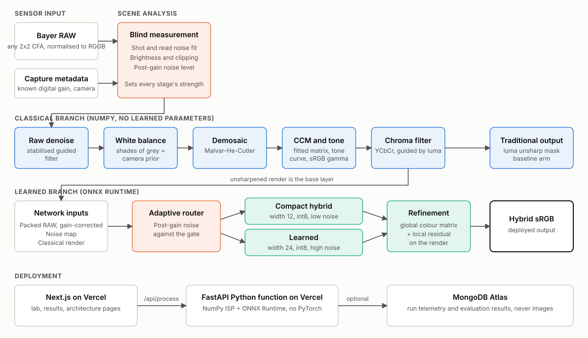
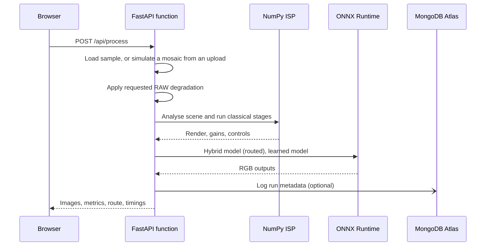

# Architecture

## Components

| Component | Location | Runs in |
|---|---|---|
| Classical ISP | `lumaforge/isp/` | Training, evaluation, API |
| Input preparation | `lumaforge/hybrid.py` | Training, evaluation, API |
| LumaNet | `lumaforge/models/lumanet.py` | Training and export only |
| ONNX runtime | `lumaforge/runtime.py` | Evaluation, API |
| API | `api/index.py` | Vercel Python function |
| Storage | `api/store.py` | Vercel Python function |
| Web interface | `app/`, `components/` | Vercel |

## Request Flow

## Processing Order

1. Crop the mosaic to RGGB phase, then to a multiple of 16.
2. Fit the noise model and measure brightness.
3. Plan the stage settings from post-gain noise.
4. Denoise in a variance-stabilised raw domain.
5. Estimate and apply white balance.
6. Demosaic. This comes after denoising, so noise is not interpolated into structure.
7. Apply the colour matrix, tone curve and gamma.
8. Filter chroma in YCbCr.
9. Send the unsharpened render, packed RAW and noise map to the routed network.

The hybrid base layer is unsharpened on purpose, because the sharpened output is only the traditional arm's final image.

## Deployment Constraints

| Constraint | Response |
|---|---|
| Python function size limit | Deploy ONNX Runtime and NumPy, never PyTorch |
| 4.5 MB request and response body limit | Resize uploads in the browser, and return JPEG images from small demo crops |
| Cold starts | Create ONNX sessions lazily, and reuse them and the MongoDB client on warm instances |
| Database outages | Short timeouts, and logging failures never stop processing |

## Data Model

MongoDB database `lumaforge`:

| Collection | Contents |
|---|---|
| `runs` | Time, source type, camera, degradation, route, scene statistics, timings and metrics |
| `results` | Generated evaluation summaries |

`runs` documents expire after 180 days through a TTL index. Images are never stored.
